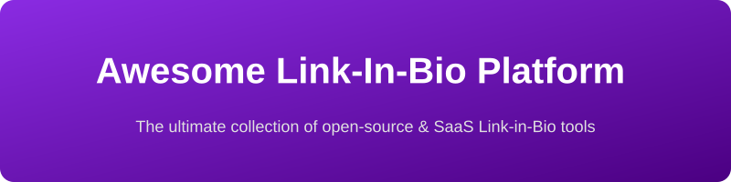

  

# 🌟 Awesome-Link-In-Bio-Platform

## 🚀 Top Link-in-Bio Platform Tools Ecosystem

**Curated List of SaaS Products & Open-Source GitHub Projects**  
*Focused on Link-in-Bio Pages, Creator Landing Pages, Social Bio Links & Single-Link Hubs*  
**Last updated: August 2026**

This repository tracks notable **SaaS platforms** and **open-source projects** for **Link-in-Bio** tools. These platforms let creators, influencers, businesses, and individuals share multiple links, content, and calls-to-action from a single URL commonly placed in social media bios.

**Examples** include Linktree, Beacons, Campsite, Bio.site, Koji, Taplink, Milkshake, Lnk.Bio, Shorby, Later Link in Bio / Linkin.bio, and Bio.fm (the category leaders).

**Open-source emphasis**: This section is heavily expanded with every major active project for self-hosting, static site generators, privacy-first alternatives, custom domains, and fully owned link pages — ideal for creators, developers, and anyone who wants to avoid monthly fees and retain full control of their data and branding.

Contributions welcome! Open a PR to add/update entries. Keep descriptions factual and link to official sites.

## 📋 Table of Contents
- [SaaS/Hosted Platforms](#saas-products)
- [Open-Source GitHub Projects](#open-source-github-projects)
- [How to Contribute](#how-to-contribute)
- [Disclaimer](#disclaimer)

## ☁️ SaaS/Hosted Platforms

| Platform | Description | Pricing & Free Tier Limits | Company Size (Valuation/Funding) |
|----------|-------------|----------------------------|----------------------------------|
| **[Bio.site](https://bio.site/)** | Simple and modern link-in-bio builder emphasizing ease of use and clean design for personal and creator pages. | **Free**: Unlimited links, basic templates. **Paid**: Pro (from ~$12/mo). | Part of Squarespace ($8B+ Valuation) |
| **[Linktree](https://linktr.ee/)** | The most widely used link-in-bio platform, offering customizable link pages, analytics, monetization tools, and integrations for creators and brands. | **Free**: Unlimited links, basic analytics, standard themes. **Paid**: Starter ($5/mo), Pro ($9/mo), Premium ($24/mo). | $1.3B Valuation (Unicorn) |
| **[Milkshake](https://milkshake.app/)** | Mobile-first link-in-bio app designed for quick creation and management of beautiful pages directly from a phone. | **Free**: Full features with watermark. **Paid**: Pro ($2.99/mo) removes watermark. | Part of Envato (Acq. for $245M) |
| **[Later Link in Bio / Linkin.bio](https://later.com/)** | Link-in-bio solution from the Later social media platform, tightly integrated with Instagram and content scheduling workflows. | **Free**: Basic link-in-bio features. **Paid**: Starter ($25/mo), Growth ($40/mo), Advanced ($80/mo). | Acquired by Mavrck (Est. $100M+) |
| **[Koji](https://withkoji.com/)** | Interactive link-in-bio and mini-app platform that supports engaging experiences beyond simple links (games, quizzes, stores, etc.). | **Free**: 100% Free. **Fees**: Monetizes via transaction fees. | Acquired by Linktree (Prev. $36M Funding) |
| **[Beacons](https://beacons.ai/)** | All-in-one creator platform combining link-in-bio pages with email marketing, digital product sales, media kits, tipping, and monetization features. | **Free**: Link-in-bio, basic store, up to 1,000 email subs. **Paid**: Creator Pro ($30/mo). | ~$30M Valuation ($6M Funding) |
| **[Campsite](https://campsite.bio/)** | Clean, design-focused link-in-bio tool popular for its flexible layouts, carousels, and professional appearance. | **Free**: Unlimited links, basic analytics. **Paid**: Pro ($7/mo), Pro+ ($24/mo). | Bootstrapped / Small |
| **[Taplink](https://taplink.at/)** | Feature-rich link-in-bio and mini-website builder with strong support for forms, payments, messengers (WhatsApp/Telegram), and lead generation. | **Free**: Basic blocks, unlimited links. **Paid**: Pro ($3/mo), Business ($6/mo). | Bootstrapped / Small |
| **[Lnk.Bio](https://lnk.bio/)** | Lightweight and affordable link-in-bio service known for generous free plans, custom domains, and embeds. | **Free**: Unlimited links, random URL. **Paid**: Mini ($0.99/mo or $10 lifetime), Unique ($25 lifetime). | Bootstrapped / Small |
| **[Shorby](https://shorby.com/)** | Dedicated link-in-bio alternative focused on clean design, analytics, and straightforward link management. | **Free**: No free tier (5-day trial). **Paid**: Rocket ($15/mo), Pro ($29/mo), Agency ($99/mo). | Bootstrapped / Small |
| **[Bio.fm](https://bio.fm/)** | Creator-oriented link-in-bio and landing page tool for sharing links, content, and offers in one place. | **Free**: 1 block, basic features. **Paid**: Pro ($5/mo). | Bootstrapped / Small |

## 💻 Open-Source GitHub Projects

- **[BioDrop (formerly LinkFree)](https://github.com/EddieHubCommunity/BioDrop)**   
  Open-source community-driven link-in-bio and profile platform that aggregates links, socials, and contributions with a focus on developers and open-source contributors.

- **[LinkStack](https://github.com/LinkStackOrg/LinkStack)**   
  Mature, self-hosted, highly customizable open-source link-in-bio platform (PHP/Laravel) with admin panel, themes, analytics, and multi-user support — the most production-ready FOSS alternative.

- **[LittleLink](https://github.com/sethcottle/littlelink)**  (+ [LittleLink-Server](https://github.com/techno-tim/littlelink-server) )  
  Minimalist, static HTML/CSS template (and Docker-friendly server version) that lets you host a clean Linktree-style page on GitHub Pages, Netlify, or any web server with zero backend required.

- **[OneLink](https://github.com/fayazara/onelink)**   
  Clever open-source approach where the entire link-in-bio configuration lives in the URL itself — fully portable, static, and backend-free.

- **[OpenBio](https://github.com/vanxh/openbio)**   
  Beautiful open-source link-in-bio page builder featuring a customizable bento-grid layout, multiple card types, and modern Next.js stack.

- **[Librelinks](https://github.com/urdadx/librelinks)**   
  Open-source link-in-bio platform with themes, analytics (views, clicks, devices, countries), and easy customization.

- **[HugoBlox Link-in-Bio Theme](https://github.com/HugoBlox/hugo-theme-link-in-bio)**   
  Fast, Markdown-owned, static link-in-bio theme with unlimited links, custom domains, and AI-assisted page generation — zero monthly fees.

- **[vp](https://github.com/im6/vp)**   
  A modern, highly customizable open-source link-in-bio built with React.

- **[urlinks](https://github.com/0x4bs3nt/urlinks)**   
  Free and fully open-source link-in-bio tool built with Django and modern front-end, focused on keeping basic link sharing free.

- **[LinkHub / various static themes](https://github.com/nilbasora/LinkHub)**   
  Static, GitHub Pages–friendly open-source Linktree alternatives configurable via simple YAML or Markdown files.

### 🧩 Additional Strong Open-Source Options

- **Static site templates** (Astro, Jekyll, Hugo, Next.js, plain HTML) specifically built as Linktree clones.
- **Self-hosted multi-user platforms** extending LinkStack or similar stacks.
- **URL-encoded / zero-backend solutions** for maximum portability and privacy.
- **Developer-focused profile pages** that combine links with GitHub stats, portfolios, and open-source activity.
- Many community forks and minimal single-file or single-repo solutions that can be deployed in minutes on free static hosting.

**Frameworks for building custom systems**: Start with **LittleLink** or a static template for the simplest self-hosted page, move to **LinkStack** for a full multi-user platform, or combine **Next.js/Astro + a headless CMS or JSON/YAML config** for complete ownership and custom features (analytics, theming, monetization).

## 🤝 How to Contribute

1. Fork the repo.
2. Add/edit entries in `README.md` (follow existing format).
3. Include: name, link, 1–2 sentence description, and whether it's SaaS or open-source.
4. Submit PR with a short explanation.

Star the repo if you find it useful!

## ⚠️ Disclaimer

- This is a **community-curated** list — not exhaustive and not an endorsement.
- Link-in-bio pages often collect analytics and may process personal data; ensure compliance with privacy regulations (GDPR, CCPA, etc.) when self-hosting or using third-party services.
- Self-hosted open-source solutions require proper security, updates, and (if collecting data) privacy policy considerations.

---

**Made for creators, influencers, developers, small businesses, and anyone who wants a single link that they actually own.**  
Let's make link-in-bio pages free, private, and open.
